# JetBrains plugins

These pieces check, sign, and publish a JetBrains plugin to the Marketplace, then open the post-release version bump.
The design rule is that every credential lives in a fresh job with no checkout and no Gradle: the build runs keyless,
the signing key and the Marketplace token each get their own job, and each job checks the digest recorded before the
artifact was uploaded.

```mermaid
flowchart LR
    check["jetbrains-plugin-check<br/>build unsigned ZIP, verify, UI tests"] --> sign["sign-jetbrains-plugin<br/>signing key, no checkout"]
    sign --> stage["stage-jetbrains-marketplace<br/>mode: stage"]
    stage -->|publish == true| upload["publish-jetbrains-marketplace<br/>upload token, no checkout"]
    upload --> verify["stage-jetbrains-marketplace<br/>mode: verify"]
    verify --> post["prepare-jetbrains-post-release<br/>+ publish-post-release-pr"]

    classDef keyless fill:#1d4ed8,stroke:#1e3a8a,color:#ffffff
    classDef secret fill:#b45309,stroke:#78350f,color:#ffffff
    class check,stage,verify keyless
    class sign,upload,post secret
```



Blue jobs hold no secret; amber jobs hold one credential each.

## Check a plugin: `jetbrains-plugin-check.yaml`

Builds the plugin ZIP, records its SHA256, runs `verifyPlugin` for each `verify-matrix` entry, and runs the Xvfb UI
tests. Its `gate` job runs `required-checks` over `build`, `verify`, and `ui-test`. Lint and unit tests stay in the
caller. It needs no secret and holds `contents: read`.

```yaml
jobs:
  plugin:
    uses: tox-dev/github-workflows/.github/workflows/jetbrains-plugin-check.yaml@SHA
    permissions:
      contents: read
```

| Input             | Default                                    | Purpose                                                                                                                                                                            |
| ----------------- | ------------------------------------------ | ---------------------------------------------------------------------------------------------------------------------------------------------------------------------------------- |
| `plugin-version`  | empty                                      | Written to `pluginVersion` in `gradle.properties` before the build, with a leading `v` removed. Empty keeps the committed value. A release caller passes `${{ github.ref_name }}`. |
| `verify-matrix`   | `[{"label":"PY","ide":"PY","version":""}]` | JSON array of `{label, ide, version}` objects. Add an entry with `version: 263-EAP-SNAPSHOT` to catch platform APIs the next release removes.                                      |
| `ui-test-timeout` | `300`                                      | Seconds (a number) to wait for the test IDE to answer on port 8082.                                                                                                                |

Outputs from the `build` job, for `sign-jetbrains-plugin`: `archive-sha256`, `archive-name`, and `artifact-id`.

The repository needs `gradle.properties` with a `pluginVersion=` line, a mise configuration providing the JDKs, and the
Gradle tasks `buildPlugin`, `verifyPlugin` (taking `-PverifyIde` and `-PverifyVersion`), `compileTestKotlin`,
`runIdeForUiTests` (with a robot server on port 8082), and `uiTest`.

The build selects exactly one ZIP that matches the version and keeps Gradle's cache off, because the ZIP feeds a signed
release; the verify and UI-test jobs do use caches. Artifacts: `unsigned-plugin` (30 days),
`pluginVerifier-result-<label>` per verify entry, and `ui-test-failure` with UI-test reports on failure (14 days). Check
names: `🏗️ Build unsigned plugin`, `🔍 Verify (<label>)`, `🧪 UI tests`, and `🚦 Required checks pass`.

## Sign: `sign-jetbrains-plugin`

Signs the unsigned ZIP from a keyless Gradle `buildPlugin` job. Run it in a fresh job on `ubuntu-26.04` (an x64 runner;
it uses the runner's Java 17) with the signing environment, no checkout, and no Gradle invocation. Download the unsigned
artifact and pass the SHA256 emitted before that artifact was uploaded.

The Action checks the file's digest and rejects a ZIP with duplicate entries, downloads JetBrains Marketplace ZIP Signer
0.1.43 from Maven Central, and verifies its pinned SHA256. It accepts plain PEM or base64 credentials and an encrypted
private key with its password. The private key is mapped only into the sign step's environment, and its temporary file
is removed when that step ends.

```yaml
sign:
  needs: build-unsigned
  runs-on: ubuntu-26.04
  environment: release
  permissions: {}
  outputs:
    archive: ${{ steps.signed.outputs.archive }}
    sha256: ${{ steps.signed.outputs.sha256 }}
  steps:
    - uses: actions/download-artifact@DOWNLOAD_SHA
      with:
        name: unsigned-plugin
        path: dist/
    - id: signed
      uses: tox-dev/github-workflows/sign-jetbrains-plugin@SHA
      with:
        archive: dist/Plugin-1.2.3.zip
        sha256: ${{ needs.build-unsigned.outputs.archive_sha }}
        certificate-chain: ${{ secrets.CERTIFICATE_CHAIN }}
        private-key: ${{ secrets.PRIVATE_KEY }}
        private-key-password: ${{ secrets.PRIVATE_KEY_PASSWORD }}
    - uses: actions/upload-artifact@UPLOAD_SHA
      with:
        name: plugin-distribution
        path: ${{ steps.signed.outputs.archive }}
        if-no-files-found: error
```

Inputs: `archive` and `sha256` **(required)** identify the unsigned ZIP; `certificate-chain` and `private-key`
**(required)** supply the signing identity; `private-key-password` only for an encrypted key. Outputs: `archive`, the
signed ZIP path (`<archive>-signed.zip` beside the input), and `sha256`, the digest to check after download in the
publisher and GitHub Release jobs.

Remote effect: downloads the pinned signer JAR; no GitHub or Marketplace write. The caller uploads the signed ZIP as an
artifact after the Action succeeds. Keep the Marketplace token in a different no-checkout job.

## Stage and verify: `stage-jetbrains-marketplace`

Checks a signed ZIP with `release-creator marketplace`. Install release-creator from the caller's locked release tools
first.

- `mode: stage` (default), before upload: outputs `publish` (`true` when no public version matches) and `channel`.
- `mode: verify`, after the version is public: compares the public member bytes and outputs nothing.

The channel is the tag suffix before the first dot: `v1.2.3-beta.1` gives `beta`, and `v1.2.3` gives an empty Stable
channel. Pass `channel` to `publish-jetbrains-marketplace`.

```yaml
  marketplace-check:
    needs: sign
    runs-on: ubuntu-26.04
    permissions:
      contents: read
    outputs:
      publish: ${{ steps.stage.outputs.publish }}
      channel: ${{ steps.stage.outputs.channel }}
    steps:
      - uses: actions/download-artifact@DOWNLOAD_SHA
        with:
          artifact-ids: ${{ needs.sign.outputs.artifact-id }}
          path: dist
      - id: stage
        uses: tox-dev/github-workflows/stage-jetbrains-marketplace@SHA
        with:
          archive: dist/Plugin-1.2.3-signed.zip
          sha256: ${{ needs.sign.outputs.sha256 }}
          plugin-id: com.github.toxdev.fish
          version: ${{ github.ref_name }}
          mode: stage
```

Inputs `archive`, `sha256`, `plugin-id`, and `version` are required; `mode` is `stage` (default) or `verify`.
`plugin-id` here is the plugin's XML ID, such as `com.github.toxdev.fish`; `version` is the release tag, its `v` prefix
removed. A digest mismatch fails.

## Publish: `publish-jetbrains-marketplace`

Uploads one signed ZIP through the
[Marketplace upload API](https://plugins.jetbrains.com/docs/marketplace/plugin-upload.html). Run it in a fresh job
without checkout or Gradle, in the `release` environment, with Actions read access, and give the workflow a concurrency
group keyed by tag so runs for the same tag are serialized. Download the signed ZIP and the release notes by the
artifact IDs from their producing jobs; the Action checks both before using the upload token.

```yaml
marketplace-publish:
  needs: [sign, notes]
  runs-on: ubuntu-26.04
  permissions:
    actions: read
  environment: release
  steps:
    - uses: actions/download-artifact@DOWNLOAD_SHA
      with:
        artifact-ids: ${{ needs.sign.outputs.artifact-id }}
        path: dist
    - uses: actions/download-artifact@DOWNLOAD_SHA
      with:
        artifact-ids: ${{ needs.notes.outputs.artifact-id }}
        path: ${{ runner.temp }}/notes
    - name: 🚀 Publish signed ZIP
      uses: tox-dev/github-workflows/publish-jetbrains-marketplace@SHA
      with:
        archive: dist/Plugin-1.2.3-signed.zip
        sha256: ${{ needs.sign.outputs.sha256 }}
        plugin-id: '29973'
        channel: ''
        tag: ${{ github.ref_name }}
        commit: ${{ github.sha }}
        signed-artifact-id: ${{ needs.sign.outputs.artifact-id }}
        notes-artifact-id: ${{ needs.notes.outputs.artifact-id }}
        notes-file: ${{ runner.temp }}/notes/release-notes.md
        github-token: ${{ github.token }}
        publish-token: ${{ secrets.PUBLISH_TOKEN }}
```

| Input                               | Purpose                                                                  |
| ----------------------------------- | ------------------------------------------------------------------------ |
| `archive`, `sha256` **(required)**  | Signed ZIP and the digest the signing job recorded.                      |
| `plugin-id` **(required)**          | Numeric Marketplace plugin ID, unlike the XML ID the stage Action takes. |
| `channel`                           | Empty for Stable; a Marketplace channel name for a prerelease.           |
| `tag`, `commit` **(required)**      | The release tag and the commit it targets.                               |
| `signed-artifact-id` **(required)** | Artifact ID holding the signed ZIP.                                      |
| `notes-artifact-id` **(required)**  | Artifact ID holding the release notes.                                   |
| `notes-file` **(required)**         | Notes downloaded from `notes-artifact-id`.                               |
| `github-token` **(required)**       | Token with Actions read permission.                                      |
| `publish-token` **(required)**      | Marketplace upload token.                                                |

Upload happens once per tag. Before uploading, the Action searches earlier runs of the tag for a started upload step. An
acceptance receipt from such a run must match the original artifact IDs, signed ZIP digest, and release notes bytes;
then the Action skips the upload and carries the receipt forward. An earlier upload step without a receipt stops for
manual reconciliation.

Pitfalls:

- Keep the publishing step named `🚀 Publish signed ZIP`. The Action recognizes that name and three older upload step
  names in prior runs; a renamed step is not recognized in earlier runs until the Action knows its name.
- The receipt check reads the earlier run's artifacts named exactly `plugin-distribution` and `release-notes`, the
  latter holding `release-notes.md`.
- Receipts are kept 30 days. A retry after that stops for manual reconciliation.

Output: a `marketplace-acceptance-<run>-<attempt>` artifact, uploaded after a new upload and when an earlier receipt is
reused. It records the tag, commit, plugin, channel, signed ZIP artifact and SHA256, and notes artifact and SHA256.
Remote effect: one multipart upload to JetBrains Marketplace when no earlier acceptance exists, plus the receipt. An
HTTP 2xx response counts as acceptance; the Action does not depend on undocumented response fields. Run the keyless
`stage` check before this job and `verify` after the version is public.

If the Action stops without a receipt, inspect the exact plugin, version, and channel in the Marketplace dashboard. If
the update is pending review, wait until it is public and verify its member bytes against the original signed ZIP. Then
rerun the tag workflow: the keyless stage check must skip the Marketplace upload before GitHub Release publication. If
Marketplace rejected the update, resolve the rejection and prepare a new release tag. A 404 alone does not authorize
another upload of the same tag.

## Post-release version bump

After a release, `pluginVersion` moves to the next development version through a pull request. The change is prepared in
a keyless job and pushed by a separate App-token job that never checks out the repository.

### `prepare-jetbrains-post-release`

Takes an `X.Y.Z` tag (a `v` prefix is accepted), writes `X.Y.(Z+1)-dev` to the version file, and commits it as the App's
bot (it reads the App's public user ID with `github-token`; it never touches the App token). It writes `paths.tsv` and
`body.md` to `output-dir`, plus `candidate.bundle` when the version file changed.

```yaml
  post-release-prepare:
    runs-on: ubuntu-26.04
    permissions:
      contents: read
    outputs:
      base-commit: ${{ steps.change.outputs.base-commit }}
      candidate-commit: ${{ steps.change.outputs.candidate-commit }}
      branch: ${{ steps.change.outputs.branch }}
      next-version: ${{ steps.change.outputs.next-version }}
      artifact-id: ${{ steps.upload.outputs.artifact-id }}
    steps:
      - uses: actions/checkout@CHECKOUT_SHA
        with:
          ref: main
          fetch-depth: 0
          persist-credentials: false
      - id: change
        uses: tox-dev/github-workflows/prepare-jetbrains-post-release@SHA
        with:
          tag: ${{ github.ref_name }}
          app-slug: tox-dev-jetbrains-fish-release
          github-token: ${{ github.token }}
          output-dir: ${{ runner.temp }}/post-release
      - id: upload
        uses: actions/upload-artifact@UPLOAD_SHA
        with:
          name: post-release-${{ github.run_id }}-${{ github.run_attempt }}
          path: ${{ runner.temp }}/post-release/*
          if-no-files-found: error
```

| Input                         | Default             | Purpose                                                |
| ----------------------------- | ------------------- | ------------------------------------------------------ |
| `tag` **(required)**          |                     | Release tag.                                           |
| `version-file`                | `gradle.properties` | File holding the `pluginVersion=` line.                |
| `output-dir` **(required)**   |                     | Directory for `paths.tsv`, `body.md`, and the bundle.  |
| `app-slug` **(required)**     |                     | Slug of the release App, used for the commit identity. |
| `github-token` **(required)** |                     | Token to read the App's public user ID.                |

Outputs: `base-commit`, `candidate-commit` (empty when the version file did not change), `branch`
(`post-release-<tag>`), and `next-version`.

### `publish-post-release-pr`

Consumes a candidate commit prepared without an App token. The preparation job records the base commit, desired branch,
and a tab-separated file of changed paths and Git blob SHA1 values, then creates a Git bundle containing
`refs/heads/release-candidate` and its full history. A thin bundle fails verification in the writer's empty bare
repository.

Upload the bundle, path file, and body as one artifact, and pass the upload step's artifact ID to the writer's download
step, so a rerun cannot select an older artifact with the same name. The writer runs without checkout in the caller's
`release-auth` environment, with `GH_TOKEN` set to an App token with Contents, Pull requests, and Issues write. Put this
Action last in the writer job, because its Git credential helper stays configured for later steps.

```yaml
  - uses: actions/download-artifact@DOWNLOAD_SHA
    with:
      artifact-ids: ${{ needs.prepare.outputs.artifact-id }}
      path: prepared/
  - uses: tox-dev/github-workflows/publish-post-release-pr@SHA
    env:
      GH_TOKEN: ${{ steps.app-token.outputs.token }}
    with:
      base-commit: ${{ needs.prepare.outputs.base-commit }}
      branch: post-release-${{ github.ref_name }}
      title: Bump version to 2.4.8-dev
      body-file: prepared/body.md
      paths-file: prepared/paths.tsv
      allowed-paths: gradle.properties
      bundle: prepared/candidate.bundle
      candidate-commit: ${{ needs.prepare.outputs.candidate-commit }}
```

| Input                          | Purpose                                                         |
| ------------------------------ | --------------------------------------------------------------- |
| `base-commit` **(required)**   | The keyless job's base commit.                                  |
| `branch` **(required)**        | Branch for the pull request.                                    |
| `title` **(required)**         | Exact pull request title.                                       |
| `body-file` **(required)**     | File holding the exact pull request body.                       |
| `paths-file` **(required)**    | One tab-separated path and desired Git blob SHA1 per line.      |
| `allowed-paths` **(required)** | Paths the candidate may change.                                 |
| `bundle`                       | The candidate bundle; empty when the change has already merged. |
| `candidate-commit`             | The candidate commit; empty when the change has already merged. |

Before any write, the Action verifies that the candidate is a single-parent commit on `base-commit`, and checks its
changed path set against `allowed-paths`, its regular file modes, and its blob identities. It targets `main` in
`GITHUB_REPOSITORY` and applies `skip news` to the pull request. No named output.

Reruns converge:

- An existing branch is not pushed again; its content is not compared. If the branch has no matching pull request, the
  Action creates one. A pull request matches only with the same title, body, and base.
- A merged pull request with a deleted branch succeeds.
- A closed, unmerged pull request fails before the Action creates a replacement branch or pull request; reopen it before
  retrying.
- When the prepared change has already merged and produced no new commit, pass empty `bundle` and `candidate-commit`
  with the same path manifest; the Action finds the merged pull request.
