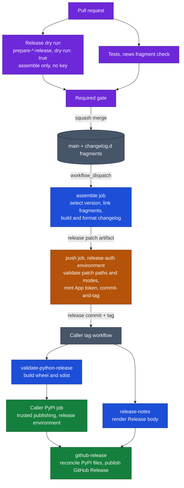

# Release flow

A release here is two workflows in the caller repository joined by a tag. A maintainer dispatches the prepare workflow;
it builds the changelog from the news fragments and pushes one release commit plus its tag. The tag starts the caller's
publish workflow, which builds the distributions, uploads them to the package index, and creates the GitHub Release.
With the dry run wired into the gate, every pull request runs the preparation first, so a change that would break the
next release fails its own checks instead.

The split keeps keys away from project code. Jobs that run hooks, build the changelog, or build packages hold read-only
tokens. Only two kinds of job hold a credential, and neither runs project code: the push job mints a short-lived App
token after checking the patch it was handed, and the publish jobs use OIDC or `contents: write` in the `release`
environment.



Purple runs on every pull request, blue holds read-only tokens, amber holds the App token, and green writes to PyPI or
GitHub Releases.

## One-time repository setup

- **Release App.** A GitHub App installed on this repository only, with Contents write and Metadata read (add Pull
  requests write if the same App opens [maintenance pull requests](maintenance.md)). Grant it bypass on the branch and
  tag rulesets so it can push the release commit to `main` and create the tag.
- **`release-auth` environment.** Restrict it to `main`. Store the App key as the `RELEASE_APP_PRIVATE_KEY` secret and
  the client ID as the `RELEASE_APP_CLIENT_ID` variable.
- **`release` environment.** Used by the PyPI and GitHub Release jobs; it must allow the tag refs. Register it as the
  PyPI trusted publisher environment.
- **Immutable releases.** Enable them before using
  [`publish-github-release`](release-publish.md#publish-github-release).
- **Lock groups.** The caller's `pylock.toml` needs `release-prepare` (release-creator, Towncrier, prek) for
  preparation, `release-notes` (release-creator) for notes, `release-news` (release-creator, Towncrier) for the news
  check, and `build` for build constraints. See [locked tools](locked-tools.md).
- **Towncrier configuration.** Committed in `towncrier.toml` or `[tool.towncrier]`, naming the changelog and fragment
  directory, and a `mdformat` (Markdown) or `docstrfmt` (reStructuredText) prek hook to format it.

## Caller files

The prepare workflow is callable, so the pull request gate can run it as a dry run with the same inputs as a real
release:

```yaml
# .github/workflows/prepare-release.yaml
name: Prepare release
on:
  workflow_dispatch:
    inputs:
      bump:
        type: choice
        options: [auto, major, minor, patch]
        default: auto
  workflow_call:
    inputs:
      dry-run:
        type: boolean
        required: true
permissions: {}
jobs:
  prepare:
    uses: >-
      tox-dev/github-workflows/.github/workflows/prepare-towncrier-release.yaml@SHA
    permissions:
      contents: read
      pull-requests: read
    with:
      bump: ${{ inputs.bump || 'auto' }}
      dry-run: ${{ inputs.dry-run == true }}
    secrets:
      RELEASE_APP_PRIVATE_KEY: ${{ secrets.RELEASE_APP_PRIVATE_KEY }}
```

The gate workflow adds one job and makes the gate depend on it, see [PR checks](pr-checks.md#release-dry-run). The tag
workflow builds, publishes and creates the GitHub Release;
[Publish a release](release-publish.md#a-complete-tag-workflow) has complete examples for a single package and for a
shared changelog.

## Pages

- [Prepare and tag a release](release-prepare.md): `prepare-towncrier-release`, `prepare-release-creator`, the dry run,
  and the Actions they run.
- [Publish a release](release-publish.md): build, release notes, PyPI verification and the GitHub Release.
- [JetBrains plugins](jetbrains.md): the Marketplace variant of the publish half.

## Test a caller before changing its release

The [Actions test suite](../tests) runs each inline `run:` block in temporary Git repositories. Test a caller's
Towncrier template, release hooks, package build, and publisher against representative source data before changing its
live release workflow, and inspect the version, patch, changelog, notes, and built package. The release dry run on pull
requests covers the preparation half on every change; nothing rehearses the publish half, which runs only on a tag.

This repository releases itself the same way: [prepare-release.yaml](../.github/workflows/prepare-release.yaml) calls
the Towncrier workflow, and [release.yaml](../.github/workflows/release.yaml) shows a GitHub-only publish path.
